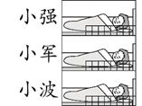

# Mathematics (Grade 3)

**ID**: ccd3840a
**难度**: medium_easy
**题型**: fill_in_the_blank

## 题目
(1)小强睡在小军的（________）面。
(2)小军的（_______）面是小波，（________）面是小强。

## 解答

**答案**: 上, 下, 上

1. Step1:观察图片可知小强在小军的上面，所以小强睡在小军的上面，第一个空填'上'
2. Step2:从图片能看出小军在小波的上面，即小波在小军的下面，第二个空填'下'
3. Step3:由图片可得小军在小强的下面，也就是小强在小军的上面，第三个空填'上'

## 知识点

**知识点**:
  - 小学数学;图形与几何;位置与方向;位置

---
