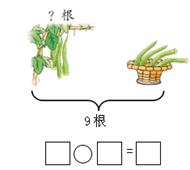

# Mathematics (Grade 3)

**ID**: cdb03f5f
**难度**: medium_easy
**题型**: fill_in_the_blank

## 题目
列式计算。

## 解答

**答案**: 5

1. Step1:观察图片可知，一共有9根，右边篮子里有4根
2. Step2:求左边的数量，用总数减去右边的数量，即9 - 4
3. Step3:计算9 - 4的结果为5

## 知识点

**知识点**:
  - 小学数学;数与代数;应用题;常见的数学问题;图文问题

---
