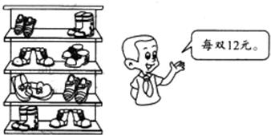

# Mathematics (Grade 3)

**ID**: d1d0ed5c
**难度**: medium_easy
**题型**: fill_in_the_blank

## 题目

10双能卖多少钱？30双呢？60双呢？
$\begin{array}{|c|c|c|c|}
\hline
双数 & 10 & 30 & 60 \\ \hline
钱数 &  &  &  \\ \hline
\end{array}$

## 解答

**答案**: 120, 360, 720

1. Step1:已知每双鞋价格为12元，求10双鞋的总价，根据乘法意义，用单价12乘双数10，即12×10 = 120元
2. Step2:求30双鞋的总价，用单价12乘双数30，即12×30 = 360元
3. Step3:求60双鞋的总价，用单价12乘双数60，即12×60 = 720元

## 知识点

**知识点**:
  - 整数的乘法及应用．

---
