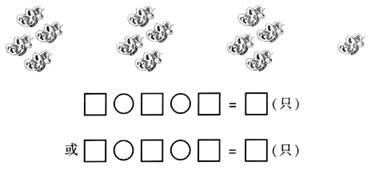

# Mathematics (Grade 3)

**ID**: d286abbd
**难度**: medium_easy
**题型**: fill_in_the_blank

## 题目
看图列式计算。

## 解答

**答案**: 4×3＋1＝13, 4×4－3＝13

1. Step1:观察图片可知，有3组数量相同的部分，每组有4只，另外还有单独的1只
2. Step2:根据上述观察，先计算3组的总数为4×3，再加上单独的1只，可列出算式4×3＋1，计算结果为13
3. Step3:假设4组数量都相同，每组4只，那么总数为4×4，但是实际有一组少3只
4. Step4:根据Step3，用假设的总数4×4减去少的3只，可列出算式4×4－3，计算结果为13

## 知识点

**知识点**:
  - 小学数学;数与代数;应用题;常见的数学问题;图文问题

---
