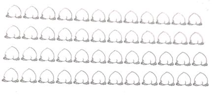

# Mathematics (Grade 3)

**ID**: d87be572
**难度**: medium_easy
**题型**: fill_in_the_blank

## 题目

上图共有48个桃子。
（1）10个装一盘，能装满（________）盘。
（2）8个装一盘，能装满（________）盘。

## 解答

**答案**: 4, 6

1. Step1:计算48个桃子，10个装一盘时，用48除以10，48÷10 = 4余8，商为4，所以能装满4盘
2. Step2:计算48个桃子，8个装一盘时，用48除以8，48÷8 = 6，商为6，所以能装满6盘

## 知识点

**知识点**:
  - 小学数学;数与代数;数的认识;整数的认识

---
