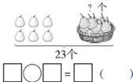

# Mathematics (Grade 3)

**ID**: dbe50741
**难度**: medium_easy
**题型**: fill_in_the_blank

## 题目
看图列式计算。

## 解答

**答案**: 17

1. Step1:观察图片可知，梨的总数是23个，左边有6个梨
2. Step2:要求右边篮子里梨的个数，用总数减去左边梨的个数，即23 - 6
3. Step3:计算23 - 6的结果为17

## 知识点

**知识点**:
  - 小学数学;数与代数;应用题;常见的数学问题;图文问题

---
