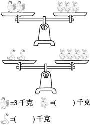

# Mathematics (Grade 3)

**ID**: dfaf31c0
**难度**: medium_easy
**题型**: fill_in_the_blank

## 题目

## 解答

**答案**: 2, 4

1. Step1:根据天平平衡可知，2只鸭子的重量等于4只鸡的重量，已知1只鸭子重3千克，所以2只鸭子重2×3 = 6千克，那么4只鸡重6千克，由此可算出1只鸡重6÷4 = 1.5千克，此结果与答案无关暂不考虑。
2. Step2:由第一个天平可知2只鸭子的重量等于4只鸡的重量，即1只鸭子的重量等于2只鸡的重量，所以第一个空应填2。
3. Step3:由第二个天平可知2只鹅的重量等于4只鸭子的重量，即1只鹅的重量等于2只鸭子的重量，已知1只鸭子重3千克，所以1只鹅重2×3 = 6千克，2只鹅重12千克，那么4只鸭子重12千克，1只鸭子重3千克，所以第二个空应填4。

## 知识点

**知识点**:
  - 小学数学;数与代数;常见的量;质量单位及换算;质量单位的换算;应用题;常见的数学问题;图文问题

---
