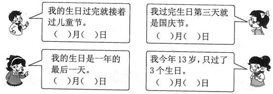

# Mathematics (Grade 3)

**ID**: f8e302eb
**难度**: medium_easy
**题型**: fill_in_the_blank

## 题目
猜一猜， 他们每个人的生日分别是几月几日？

## 解答

**答案**: 5月31日, 9月28日, 12月31日, 2月29日

1. Step1:因为儿童节是6月1日，生日过完就接着过儿童节，所以生日是5月的最后一天，5月有31天，这个生日是5月31日
2. Step2:因为国庆节是10月1日，过完生日第三天就是国庆节，10月1日往前推3天，9月有30天，所以这个生日是9月28日
3. Step3:一年的最后一个月是12月，12月有31天，所以一年的最后一天是12月31日
4. Step4:13岁只过了3个生日，说明生日不是每年都有，只有闰年2月29日符合，闰年每4年一次

## 知识点

**知识点**:
  - 

---
