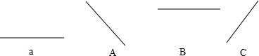

# Mathematics (Grade 3)

**ID**: 1372062f
**难度**: medium_easy
**题型**: multiple_choice

## 题目
下面的平面中，与直线a平行的是（  ）

A．A
B．B
C．C

## 解答

**答案**: B

1. Step1:明确平行的定义为在同一平面内，不相交的两条直线叫做平行线
2. Step2:观察题目中的直线a以及选项A、B、C
3. Step3:根据平行的定义判断出与直线a平行的是直线B

## 知识点

**知识点**:
  - 垂直与平行的特征及性质．

---
