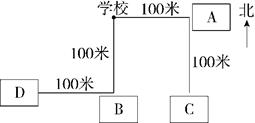

# Mathematics (Grade 3)

**ID**: 71a79b5d
**难度**: medium_easy
**题型**: multiple_choice

## 题目
小丽从家出发，先向北走100米，再向西走100米到达学校。图中哪个字母表示小丽家？

## 解答

**答案**: C

1. Step1:根据题意，小丽从家出发先向北走100米，再向西走100米到达学校，那么反过来从学校出发，先向东走100米，再向南走100米就是小丽家。
2. Step2:观察图，从学校向东走100米到达A点，再从A点向南走100米到达C点。
3. Step3:所以图中C点表示小丽家。

## 知识点

**知识点**:
  - 小学数学;图形与几何;位置与方向;路线图;根据方向、角度和距离确定物体的位置

---
