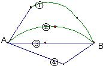

# Mathematics (Grade 3)

**ID**: c3085c97
**难度**: medium_easy
**题型**: multiple_choice

## 题目
如图，在从A到B的四条路径中，最短的路径是(    )．

## 解答

**答案**: ③

1. Step1:明确题目是在从A到B的四条路径中找最短路径
2. Step2:依据两点之间，线段最短这一原理
3. Step3:观察四条路径，发现路径③是线段
4. Step4:得出最短路径是③

## 知识点

**知识点**:
  - 长度的测量方法．

---
