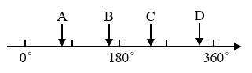

# Mathematics (Grade 3)

**ID**: e279f3cd
**难度**: medium_easy
**题型**: multiple_choice

## 题目
下面的（）点，表示的是钝角。 

A.A
B.B
C.C
D.D

## 解答

**答案**: B

1. Step1:明确钝角的定义为角度大于90°小于180°的角
2. Step2:观察图中A点对应的角度，判断其小于90°
3. Step3:观察图中C、D点对应的角度，判断其大于180°
4. Step4:观察图中B点对应的角度，判断其处在90°到180°之间
5. Step5:根据钝角定义及各点角度判断，得出表示钝角的是B点

## 知识点

**知识点**:
  - 

---
