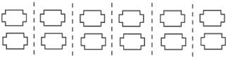

# Mathematics (Grade 3)

**ID**: e855db13
**难度**: medium_easy
**题型**: multiple_choice

## 题目
不符合图意的说法或算式是（  ）
A．6个2
B．6+6
C．6×2
D．2×6

## 解答

**答案**: B

1. Step1:观察图片可知，每组有2个图形，一共有6组
2. Step2:根据乘法的意义，求几个相同加数的和的简便运算用乘法，这里是6个2相加，可写成乘法算式2×6或6×2
3. Step3:逐一分析选项，A选项6个2符合图意；C选项6×2符合图意；D选项2×6符合图意；B选项6+6表示2个6相加，不符合图意

## 知识点

**知识点**:
  - 图文应用题．

---
