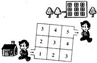

# Mathematics (Grade 3)

**ID**: 1a7ed426
**难度**: medium_easy
**题型**: short_answer

## 题目
小兵按1、2、3、4、5的顺序可以怎样走？有几条路？

## 解答

**答案**: 6条

1. Step1:明确小兵要按1、2、3、4、5的顺序走，需要找出所有可能的路径
2. Step2:通过对图中路线的分析和列举，得出路径数量
3. Step3:确定路径数量为6条

## 知识点

**知识点**:
  - 小学数学;数与代数;数的认识;整数的认识;探索规律;数字排列的规律

---
