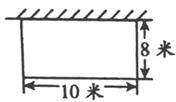

# Mathematics (Grade 3)

**ID**: 2be8fdfe
**难度**: medium_easy
**题型**: short_answer

## 题目
一块长方形菜地，长10米，宽8米。四周围上篱笆，如果一面靠墙(如下图)，篱笆至少要多少米？

## 解答

**答案**: 26米

1. Step1:分析题目可知，要求篱笆至少的长度，应让长的一边靠墙
2. Step2:此时篱笆长度为两个宽加一个长
3. Step3:已知宽是8米，长是10米，所以篱笆长度为8×2 + 10
4. Step4:计算8×2 + 10 = 16 + 10 = 26米

## 知识点

**知识点**:
  - 小学数学;数与代数;应用题;常见的数学问题;图文问题;图形与几何;平面图形;长方形和正方形;长方形的周长

---
