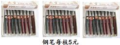

# Mathematics (Grade 3)

**ID**: 4f22a2ed
**难度**: medium_easy
**题型**: short_answer

## 题目
张老师为了奖励孩子们，给孩子们买了3盒钢笔，每盒9支．张老师一共花了多少钱？

## 解答

**答案**: 135

1. Step1:根据已知条件，每盒有9支钢笔，买了3盒，先计算出钢笔的总支数，即9×3 = 27支
2. Step2:已知每支钢笔5元，用钢笔的总支数27支乘以每支钢笔的单价5元，即5×27
3. Step3:计算5×27的结果为135元

## 知识点

**知识点**:
  - 整数的乘法及应用．

---
