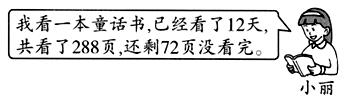

# Mathematics (Grade 3)

**ID**: 66a4a33a
**难度**: medium_easy
**题型**: short_answer

## 题目
小丽照这样的速度看完这本童话书，一共需要多少天？

## 解答

**答案**: 15天

1. Step1:先计算出这本书的总页数，即288 + 72
2. Step2:再计算出小丽每天看的页数，即288÷12
3. Step3:最后用总页数除以每天看的页数，即(288 + 72)÷(288÷12)，得出看完这本书一共需要的天数

## 知识点

**知识点**:
  - 小学数学;数与代数;应用题;复合应用题;整数四则复合应用题

---
