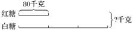

# Mathematics (Grade 3)

**ID**: 6d2de4cb
**难度**: medium_easy
**题型**: short_answer

## 题目
看图列算式，并计算。

## 解答

**答案**: 240(千克), 320(千克)

1. Step1:从图中可知白糖有80千克，红糖是白糖的3倍，所以先计算红糖的重量，根据倍数关系用乘法，即80×3 = 240(千克)
2. Step2:再计算白糖和红糖的总重量，将红糖的240千克与白糖的80千克相加，240 + 80 = 320(千克)

## 知识点

**知识点**:
  - 小学数学;数与代数;应用题;常见的数学问题;图文问题

---
