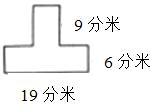

# Mathematics (Grade 3)

**ID**: 7c66e376
**难度**: medium_easy
**题型**: short_answer

## 题目
计算下面这个图形的周长.

## 解答

**答案**: 68分米

1. Step1:观察图形可知，该图形的周长可通过将各边长度相加得到
2. Step2:图形的上边长度为9分米，下边长度为19分米，左边长度为9 + 6分米，右边长度为9 + 6分米
3. Step3:所以周长的计算式为9+9+6+6+19+19
4. Step4:计算9+9+6+6+19+19的结果为68分米

## 知识点

**知识点**:
  - 

---
