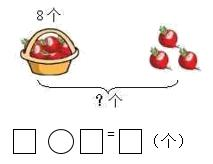

# Mathematics (Grade 3)

**ID**: 881cbab7
**难度**: medium_easy
**题型**: short_answer

## 题目
看图列式计算。

## 解答

**答案**: 11

1. Step1:观察图片可知，篮子里有8个草莓，篮子外有3个草莓
2. Step2:求草莓的总数，需将篮子里和篮子外的草莓数量相加
3. Step3:进行计算8 + 3 = 11
4. Step4:得出草莓总数为11个

## 知识点

**知识点**:
  - 小学数学;数与代数;应用题;常见的数学问题;图文问题

---
