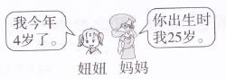

# Mathematics (Grade 3)

**ID**: a225e5eb
**难度**: medium_easy
**题型**: short_answer

## 题目

妈妈今年多少岁?

## 解答

**答案**: 29

1. Step1:因为姐姐出生时妈妈25岁，姐姐今年4岁，这意味着从姐姐出生到现在过了4年
2. Step2:所以妈妈今年的年龄是姐姐出生时妈妈的年龄25岁加上这过去的4年，即25 + 4
3. Step3:计算25 + 4的结果为29岁

## 知识点

**知识点**:
  - 小学数学;数与代数;应用题;简单应用题

---
