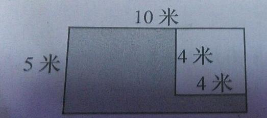

# Mathematics (Grade 3)

**ID**: d505a0ec
**难度**: medium_easy
**题型**: short_answer

## 题目
求下图阴影部分的面积。

 10米 5米  4米 4米

## 解答

**答案**: 34

1. Step1:明确长方形的长为10米，宽为5米，根据长方形面积公式S=长×宽，可得长方形面积为10×5=50平方米
2. Step2:明确正方形的边长为4米，根据正方形面积公式S=边长×边长，可得正方形面积为4×4=16平方米
3. Step3:根据阴影部分的面积=长方形的面积-正方形的面积，计算阴影部分面积为50 - 16 = 34平方米

## 知识点

**知识点**:
  - 

---
