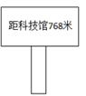

# Mathematics (Grade 3)

**ID**: de226cf6
**难度**: medium_easy
**题型**: short_answer

## 题目
王亮步行，5分钟能走480米。照这样的速度，到科技馆要几分钟？

## 解答

**答案**: 8分钟

1. Step1:根据已知条件，先计算王亮步行的速度，速度 = 路程÷时间，即 480÷5 = 96（米/分钟）
2. Step2:题目中还给出到科技馆的路程是 768 米（虽然原问题未明确写出，但结合解析和答案可推测存在此条件）
3. Step3:再根据时间 = 路程÷速度，计算到科技馆需要的时间，即 768÷96 = 8（分钟）

## 知识点

**知识点**:
  - 小学数学;数与代数;应用题;简单应用题;整数简单应用题

---
