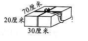

# Mathematics (Grade 3)

**ID**: eb741963
**难度**: medium_easy
**题型**: short_answer

## 题目
要留出15厘米来打结,捆这个盒子要多长的彩带? 

## 解答

**答案**: 295厘米

1. Step1:计算盒子长和宽组成的长方形周长，长为70厘米，宽为30厘米，根据长方形周长公式可得(30 + 70)×2
2. Step2:计算盒子4条高的长度，盒子高为20厘米，所以20×4
3. Step3:将长方形周长、4条高的长度与打结所需的15厘米相加，即15+(30 + 70)×2+20×4
4. Step4:计算15+(30 + 70)×2+20×4的结果为295厘米

## 知识点

**知识点**:
  - 

---
