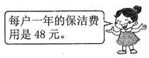

# Mathematics (Grade 3)

**ID**: f804277c
**难度**: medium_easy
**题型**: short_answer

## 题目
利民小区1号楼有132户，一年的保洁费用一共是多少元？ 

## 解答

**答案**: 6336

1. Step1:明确已知条件，每户一年的保洁费用是48元，利民小区1号楼有132户。
2. Step2:根据总价 = 单价×数量的关系，这里每户的保洁费用是单价，楼的户数是数量，所以求一年的保洁总费用需用48乘以132。
3. Step3:计算48×132的结果为6336元。

## 知识点

**知识点**:
  - 小学数学;数与代数;应用题;简单应用题

---
