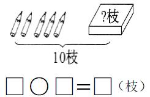

# Mathematics (Grade 3)

**ID**: f8bc0da2
**难度**: medium_easy
**题型**: short_answer

## 题目
看图列式计算．

## 解答

**答案**: 5

1. Step1:观察图片可知，铅笔一共有10枝，左边有5枝
2. Step2:要求右边盒子里铅笔的枝数，用总数减去左边的枝数，即10 - 5
3. Step3:计算10 - 5的结果为5

## 知识点

**知识点**:
  - 小学数学;数与代数;应用题;常见的数学问题;图文问题

---
