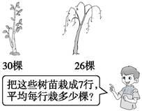

# Mathematics (Grade 3)

**ID**: f96f72bc
**难度**: medium_easy
**题型**: short_answer

## 题目

## 解答

**答案**: 8棵

1. Step1:先计算树苗的总数，即30 + 26 = 56棵
2. Step2:已知要栽成7行，用树苗总数除以行数，即56÷7 = 8棵

## 知识点

**知识点**:
  - 小学数学;数与代数;应用题;常见的数学问题;图文问题;复合应用题

---
