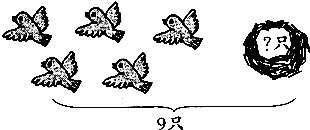

# Mathematics (Grade 3)

**ID**: 0410f67e
**难度**: medium
**题型**: fill_in_the_blank

## 题目
想一想，做一做

□○□=□（只）

## 解答

**答案**: 9, 5, 4

1. Step1:观察图片可知，小鸟的总数是9只，窝外有5只小鸟
2. Step2:题目所求为窝里小鸟的数量
3. Step3:根据整数减法的意义，用小鸟的总数减去窝外小鸟的数量就能得到窝里小鸟的数量，即9 - 5
4. Step4:计算9 - 5的结果为4，所以窝里有4只小鸟，最终答案为9、5、4

## 知识点

**知识点**:
  - 图文应用题；整数的加法和减法．

---
