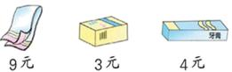

# Mathematics (Grade 3)

**ID**: 0567f2f4
**难度**: medium
**题型**: fill_in_the_blank

## 题目

（1）小红买6盒牙膏要多少元？
□○□=□（  ）
（2）如果付出30元，应找回多少元？
□○□=□（  ）
（3）买一条毛巾的钱可以买几块肥皂？
□○□=□（  ）

## 解答

**答案**: 24, 6, 3

1. Step1:已知一盒牙膏4元，求买6盒牙膏的钱数，用每盒牙膏的价格乘以购买的盒数，即4×6=24（元）
2. Step2:已知付出30元，买6盒牙膏花了24元，求应找回的钱数，用付出的钱数减去买牙膏花的钱数，即30 - 24 = 6（元）
3. Step3:已知一条毛巾9元，一块肥皂3元，求买一条毛巾的钱可以买几块肥皂，用毛巾的价格除以肥皂的价格，即9÷3=3（块）

## 知识点

**知识点**:
  - 小学数学;数与代数;应用题;常见的数学问题;经济问题

---
