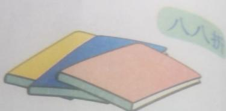

# Mathematics (Grade 3)

**ID**: 0a19e628
**难度**: medium
**题型**: fill_in_the_blank

## 题目

 八八折
 原价：35.00
 现价：______

## 解答

**答案**: 30.8

1. Step1:明确八八折的含义，即现价是原价的88%
2. Step2:已知原价为35.00，根据“原价×88%=现价”的关系，列出算式35×88%
3. Step3:计算35×88%的结果，得到30.8，此即为现价

## 知识点

**知识点**:
  - --

---
