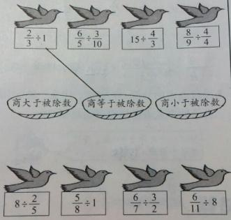

# Mathematics (Grade 3)

**ID**: 1098d08a
**难度**: medium
**题型**: fill_in_the_blank

## 题目

 两个不为0的数相除，如果除数小于1，那么商(    )；如果除数大于1，那么商(    )被除数；如果除数大于1，那么商(    )被除数.

## 解答

**答案**: 大于, 小于, 等于

1. Step1:分析除数小于1的情况，因为除数小于1就是一个小于1的小数或分数，根据除法运算性质，此时商大于被除数
2. Step2:分析除数大于1的情况，根据除法运算性质，此时商小于被除数
3. Step3:分析除数等于1的情况，根据除法运算性质，此时商等于被除数

## 知识点

**知识点**:
  - --

---
