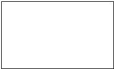

# Mathematics (Grade 3)

**ID**: 11b3c8ef
**难度**: medium
**题型**: fill_in_the_blank

## 题目
测量右边的长方形，完成下面各题．
（1）这个长方形的长是(    )，宽是(    )
（2）这个长方形的周长和面积各是多少？

## 解答

**答案**: 5厘米, 3厘米, 16厘米, 15平方厘米

1. Step1:使用测量工具测量长方形的长，得到长是5厘米
2. Step2:使用测量工具测量长方形的宽，得到宽是3厘米
3. Step3:根据长方形周长公式C=2(a + b)，其中a=5厘米，b=3厘米，计算周长为2×(5 + 3)=16厘米
4. Step4:根据长方形面积公式S = ab，其中a=5厘米，b=3厘米，计算面积为5×3=15平方厘米

## 知识点

**知识点**:
  - 长度的测量方法；长方形的周长；长方形、正方形的面积．

---
