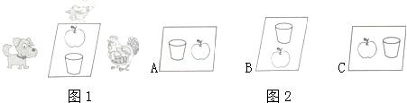

# Mathematics (Grade 3)

**ID**: 1afcb8a1
**难度**: medium
**题型**: fill_in_the_blank

## 题目
小动物观察物体．它们分别看到的是A、B、C中的哪幅图？

 小猪(    )小狗(    )公鸡(    )．

## 解答

**答案**: B, C, A

1. Step1:根据解析2可知，小狗看到的图形是左边是苹果，右边是杯子，观察图2中A、B、C，发现图形C符合小狗看到的情况，所以小狗看到的是C
2. Step2:根据解析2可知，公鸡看到的图形是左边是杯子，右边是苹果，观察图2中A、B、C，发现图形A符合公鸡看到的情况，所以公鸡看到的是A
3. Step3:根据解析2可知，小猪看到的是前面是苹果，苹果后面是杯子，观察图2中A、B、C，发现图形B符合小猪看到的情况，所以小猪看到的是B

## 知识点

**知识点**:
  - 从不同方向观察物体和几何体．

---
