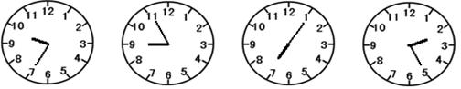

# Mathematics (Grade 3)

**ID**: 1dd813bd
**难度**: medium
**题型**: fill_in_the_blank

## 题目
写出钟面时刻。

_______    ________     ________    ________

## 解答

**答案**: 9：35, 9：55, 7：05, 2：25

1. Step1:观察第一个钟面，时针在9和10之间，分针指向7，因为分针每走一大格代表5分钟，7×5 = 35，所以时刻是9：35
2. Step2:观察第二个钟面，时针在9和10之间，分针指向11，11×5 = 55，所以时刻是9：55
3. Step3:观察第三个钟面，时针在7和8之间，分针指向1，1×5 = 5，所以时刻是7：05
4. Step4:观察第四个钟面，时针在2和3之间，分针指向5，5×5 = 25，所以时刻是2：25

## 知识点

**知识点**:
  - 小学数学;数与代数;常见的量;时间单位及换算;认识钟面指针及时间读法

---
