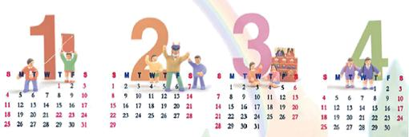

# Mathematics (Grade 3)

**ID**: 22ead185
**难度**: medium
**题型**: fill_in_the_blank

## 题目
查看2004年一月至四月的年历，回答问题：

（1）2004年的“元旦”是星期几？（________）
（2）2004年的4月10日是星期几？（___________）2004年是平年还是闰年？（_______）
（3）2004年3月的第二个星期六是几日？（_______）

## 解答

**答案**: 四, 六, 闰, 13日

1. Step1:查看2004年一月年历，确定2004年“元旦”（1月1日）是星期四
2. Step2:查看2004年四月年历，确定2004年4月10日是星期六
3. Step3:根据闰年的判断方法，能被4整除但不能被100整除的年份为闰年，2004能被4整除，所以2004年是闰年
4. Step4:查看2004年三月年历，找到第二个星期六是13日

## 知识点

**知识点**:
  - 小学数学;数与代数;常见的量;时间单位及换算;年、月、日的认识及换算;平年、闰年的认识及判定方法

---
