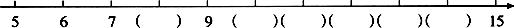

# Mathematics (Grade 3)

**ID**: 28c491fe
**难度**: medium
**题型**: fill_in_the_blank

## 题目

(1)上面最小的数是(    )，最大的数是(    )。
(2)从左往右数，第4个数是(    )。从右往左数，第4个数是(    )。
(3)与8相邻的两个数分别是(    )和(    )。

## 解答

**答案**: 5, 15, 8, 12, 7, 9

1. Step1:观察数列可知，其中最小的数是5
2. Step2:观察数列可知，其中最大的数是15
3. Step3:从左往右数，第4个数是8
4. Step4:从右往左数，第4个数是12
5. Step5:与8相邻的两个数分别是7和9

## 知识点

**知识点**:
  - 

---
