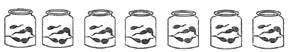

# Mathematics (Grade 3)

**ID**: 290b9fcf
**难度**: medium
**题型**: fill_in_the_blank

## 题目

（1）一共有多少只小蝌蚪？
□〇□＝□（   ）
（2）如果把这些小蝌蚪平均放在5个瓶子里，那么每个瓶子装多少只小蝌蚪？
□〇□＝□（   ）
（3）如果每个瓶子里装7只小蝌蚪，那么需要多少个瓶子？
□〇□＝□（   ）

## 解答

**答案**: 35, 7, 5

1. Step1:观察图片可知每个罐子有7只小蝌蚪，一共有5个罐子，求一共有多少只小蝌蚪，就是求5个7是多少，用乘法计算，可得5×7=35（只）或7×5=35（只）
2. Step2:已知一共有35只小蝌蚪，要平均放在5个瓶子里，求每个瓶子装多少只小蝌蚪，就是把35平均分成5份，求每份是多少，用除法计算，即35÷5=7（只）
3. Step3:已知一共有35只小蝌蚪，每个瓶子装7只小蝌蚪，求需要多少个瓶子，就是求35里面有几个7，用除法计算，所以35÷7=5（个）

## 知识点

**知识点**:
  - 小学数学;数与代数;应用题;常见的数学问题;图文问题

---
