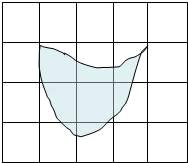

# Mathematics (Grade 3)

**ID**: 2a7615c8
**难度**: medium
**题型**: fill_in_the_blank

## 题目
如图，每个方格的边长是1厘米，方格纸上心形图的面积大约是_____平方厘米．

## 解答

**答案**: 4

1. Step1:明确每个方格的边长为1厘米
2. Step2:根据正方形面积公式，计算出每个方格的面积为1×1 = 1平方厘米
3. Step3:数出图中不是整方格的数量为8个
4. Step4:估算8个不是整方格的大约相当于4个整方格
5. Step5:用相当于整方格的数量4乘以每个方格的面积1平方厘米，即4×1 = 4平方厘米，得到心形图的大约面积

## 知识点

**知识点**:
  - 

---
