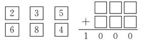

# Mathematics (Grade 3)

**ID**: 2b0d1a82
**难度**: medium
**题型**: fill_in_the_blank

## 题目
用下面6张数字卡片组成两个三位数，使它们的和是1000。

## 解答

**答案**: 352, 648

1. Step1:明确要组成两个三位数且和为1000，根据解题方法提示，确定两个三位数最高位百位的数字之和需是9
2. Step2:尝试不同数字组合，使百位数字和为9，例如2和7、3和6等
3. Step3:在确定百位数字后，再根据后面的两位数之和加起来是100的要求，组合十位和个位数字
4. Step4:经过尝试得到352和648这组数字，3+6=9，52+48=100，满足和为1000的条件

## 知识点

**知识点**:
  - 整数的加法和减法

---
