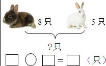

# Mathematics (Grade 3)

**ID**: 324dab15
**难度**: medium
**题型**: fill_in_the_blank

## 题目

## 解答

**答案**: 8, +, 5, 13

1. Step1:观察图片可知，图中有8只灰兔
2. Step2:图中还有5只白兔
3. Step3:题目要求计算兔子的总数
4. Step4:根据数量关系，总数等于灰兔数量加白兔数量，即要用8加上5
5. Step5:计算8+5的结果为13

## 知识点

**知识点**:
  - 整数的加法和减法．

---
