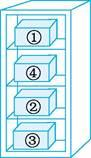

# Mathematics (Grade 3)

**ID**: 33afc927
**难度**: medium
**题型**: fill_in_the_blank

## 题目
欢欢把一块手表放在盒子里,但他忘记放在哪个盒子里了,只记得在①号盒子下面的几个盒子里,但不在②号盒子里,也不在最下面的盒子里。

（1）④号盒子的上面是（____）号盒子。
（2）最下面的是（_____）号盒子。
（3）手表在（_____）号盒子里。

## 解答

**答案**: ①, ③, ④

1. Step1:根据条件“在①号盒子下面的几个盒子里，但不在②号盒子里，也不在最下面的盒子里”，可知手表在④号盒子里。
2. Step2:观察图片可知，④号盒子的上面是①号盒子。
3. Step3:从图片能看出，最下面的是③号盒子。

## 知识点

**知识点**:
  - 

---
