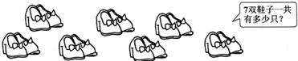

# Mathematics (Grade 3)

**ID**: 35918356
**难度**: medium
**题型**: fill_in_the_blank

## 题目

加法算式：□+□+□+□+□+□+□=□（只）
乘法算式：□×□=□（只）或□×□=□（只）

## 解答

**答案**: 2, 2, 2, 2, 2, 2, 2, 14, 2, 7, 14, 7, 2, 14

1. Step1:明确有7双鞋子，每双鞋子2只
2. Step2:根据加法意义，列出加法算式，7个2相加，即2+2+2+2+2+2+2
3. Step3:计算加法算式2+2+2+2+2+2+2的结果为14
4. Step4:根据乘法意义，每双2只，共7双，列出乘法算式2×7
5. Step5:计算乘法算式2×7的结果为14
6. Step6:交换因数位置，列出乘法算式7×2
7. Step7:计算乘法算式7×2的结果为14

## 知识点

**知识点**:
  - 整数的乘法及应用；整数的加法和减法．

---
