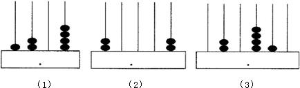

# Mathematics (Grade 3)

**ID**: 36e3a3f1
**难度**: medium
**题型**: fill_in_the_blank

## 题目
写一写，读一读．

（1）写作(    )读作(    )
（2）写作(    )读作(    )
（3）写作(    )读作(    )．

## 解答

**答案**: 12.04, 十二点零四, 20.002, 二十点零零二, 20.41, 二十点四一

1. Step1:观察第一个计数器，个位有1个算珠写作1，十位有1个算珠写作10，十分位没有算珠写作0，百分位有4个算珠写作0.04，合起来写作12.04，读作十二点零四
2. Step2:观察第二个计数器，个位没有算珠写作0，十位有2个算珠写作20，十分位、百分位没有算珠写作0.00，千分位有2个算珠写作0.002，合起来写作20.002，读作二十点零零二
3. Step3:观察第三个计数器，个位没有算珠写作0，十位有2个算珠写作20，十分位有4个算珠写作0.4，百分位有1个算珠写作0.01，合起来写作20.41，读作二十点四一

## 知识点

**知识点**:
  - 小数的读写、意义及分类．

---
