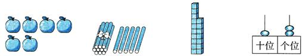

# Mathematics (Grade 3)

**ID**: 3d9bc517
**难度**: medium
**题型**: fill_in_the_blank

## 题目
数一数，写一写。

（_____）         （_____）         （_____）      （_____）

## 解答

**答案**: 6, 15, 17, 12

1. Step1:数第一个图中苹果的数量，得出是6个
2. Step2:数第二个图中铅笔的数量，一捆10支加上另外5支，得出是15支
3. Step3:数第三个图中小方块的数量，一摞10个加上另外7个，得出是17个
4. Step4:看第四个图中计数器上的珠子，十位1个珠子表示1个十，个位2个珠子表示2个一，合起来是12

## 知识点

**知识点**:
  - 小学数学;数与代数;数的认识;整数的认识

---
