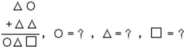

# Mathematics (Grade 3)

**ID**: 47e7a16a
**难度**: medium
**题型**: fill_in_the_blank

## 题目

## 解答

**答案**: 1, 9, 0

1. Step1: 由两个两位数相加得到三位数，可知和的百位上的○是1
2. Step2: 因为△加△的和要向前一位进一，所以△是大于5的数
3. Step3: 由于△加△加○（1）与△的和是△，○与△的和只能向前一位进1，由此可推出△是9
4. Step4: 计算9 + 1 = 10，所以□是9 + 1和的末尾的数0

## 知识点

**知识点**:
  - 竖式数字谜．

---
