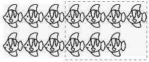

# Mathematics (Grade 3)

**ID**: 4ea83dbb
**难度**: medium
**题型**: fill_in_the_blank

## 题目
看图填空

13-7=□（条）

## 解答

**答案**: 6

1. Step1:观察图片可知鱼的总数为13条
2. Step2:看到右边圈住的鱼有7条
3. Step3:题目要求计算13 - 7的结果
4. Step4:根据减法运算得出13 - 7 = 6
5. Step5:所以13 - 7的结果为6，即填空处应填6

## 知识点

**知识点**:
  - 看图列式

---
