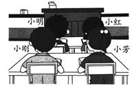

# Mathematics (Grade 3)

**ID**: 5bf71408
**难度**: medium
**题型**: fill_in_the_blank

## 题目
看图填一填。

(1)小刚的（_____）边是小芳。
(2)小红的左边是（_____）。
(3)小红在小芳的（_____）面，在小明的（_____）边。
(4)小明的（_____）面是小刚。

## 解答

**答案**: 右, 小明, 前, 右, 后

1. Step1:观察图片中人物的位置关系，确定小刚和小芳的相对位置，可知小刚的右边是小芳
2. Step2:观察小红的左边，可得出小红的左边是小明
3. Step3:观察小红与小芳、小明的位置关系，可知小红在小芳的前面，在小明的右边
4. Step4:观察小明和小刚的位置关系，可知小明的后面是小刚

## 知识点

**知识点**:
  - 小学数学;图形与几何;位置与方向;位置

---
