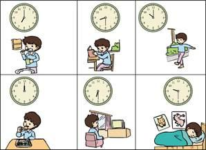

# Mathematics (Grade 3)

**ID**: 5ee9b493
**难度**: medium
**题型**: fill_in_the_blank

## 题目
明明一天的生活。

(1)明明早上（____）起床,他（____）做操。
(2)明明晚上看电视的时间是（_____）。

## 解答

**答案**: 7时(7:00), 10时(10:00), 6时半(6:30)

1. Step1:观察图片，第一个时钟显示时针指向7，分针指向12，所以明明早上7时(7:00)起床
2. Step2:第三个时钟显示时针指向10，分针指向12，所以明明10时(10:00)做操
3. Step3:第五个时钟显示时针在6和7之间，分针指向6，所以明明晚上看电视的时间是6时半(6:30)

## 知识点

**知识点**:
  - 小学数学;数与代数;常见的量;时间单位及换算;认识钟面指针及时间读法

---
