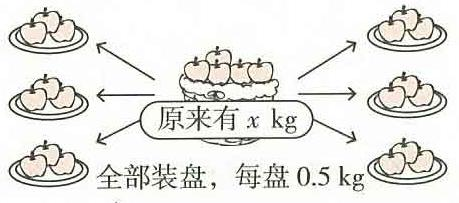

# Mathematics (Grade 3)

**ID**: 6a9ef903
**难度**: medium
**题型**: fill_in_the_blank

## 题目
有6盘苹果，每盘装0.5千克，这6盘苹果共有多少千克？

## 解答

**答案**: 3

1. Step1:明确已知条件，有6盘苹果，每盘重0.5千克
2. Step2:根据乘法的意义，求6盘苹果的总重量就是求6个0.5千克是多少
3. Step3:列出乘法算式0.5×6
4. Step4:计算0.5×6的结果为3千克

## 知识点

**知识点**:
  - 八、总复习-第二课时  数与代数二-

---
