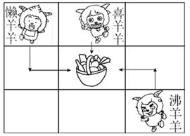

# Mathematics (Grade 3)

**ID**: 6c860924
**难度**: medium
**题型**: fill_in_the_blank

## 题目
美味的草饼．

1．懒羊羊要找到草饼，应先向（____）走，再向（____）走．
2．喜羊羊要找到草饼，应向（____）走．
3．沸羊羊要找到草饼，应先向（____）走，再向（____）走．

## 解答

**答案**: 下, 右, 下, 上, 左

1. Step1:根据题目可知，需要确定懒羊羊、喜羊羊、沸羊羊找到草饼的行走方向。
2. Step2:观察图片，判断懒羊羊的位置，要找到草饼，应先向下走，再向右走。
3. Step3:观察喜羊羊的位置，其要找到草饼应向下走。
4. Step4:观察沸羊羊的位置，其要找到草饼应先向上走，再向左走。
5. Step5:将懒羊羊、喜羊羊、沸羊羊找到草饼的行走方向依次整理为['下', '右', '下', '上', '左']。

## 知识点

**知识点**:
  - 

---
